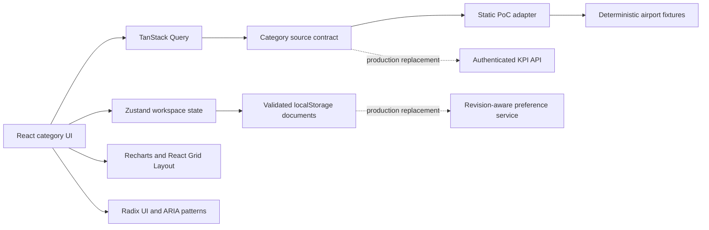

# AeroPulse — technology stack

This document describes the technology used by the current proof of concept, where each tool is used, and which parts are expected to change for production. Dependency versions are pinned in `package.json` and `package-lock.json`.

## Stack overview

| Area                           | Technology                                                        | Current responsibility                                                                                    |
| ------------------------------ | ----------------------------------------------------------------- | --------------------------------------------------------------------------------------------------------- |
| Runtime and package management | Node.js 24 LTS and npm                                            | Local development, dependency installation, validation, and production builds                             |
| Application framework          | React 19.3 and React DOM 19.3                                     | Component model, rendering, context providers, and interactive dashboard behavior                         |
| Language                       | TypeScript 6.0                                                    | Typed KPI catalogs, filters, layouts, data contracts, components, and tests                               |
| Build tooling                  | Vite 8.3 with `@vitejs/plugin-react`                              | Development server, optimized static build, environment-specific base path, and vendor chunking           |
| Styling                        | Tailwind CSS 4.3 plus project CSS and semantic design tokens      | Responsive layout, light/dark themes, dashboard surfaces, controls, and visualization styling             |
| Typography                     | Inter variable font through `@fontsource-variable/inter`          | Bundled, consistent interface typography without a runtime font request                                   |
| Icons                          | Lucide React 1.47                                                 | Navigation, card actions, filters, layout controls, and status affordances                                |
| Charts                         | Recharts 3.10                                                     | Responsive line, bar, area, composed, and categorical KPI visualizations                                  |
| Draggable grid                 | React Grid Layout 2.2                                             | Card positioning, compaction, pointer dragging, and edge/corner resizing                                  |
| Accessible UI primitives       | Radix UI Dialog and Dropdown Menu                                 | Focus-managed KPI dialogs, mobile navigation, card menus, and keyboard interaction                        |
| Asynchronous data state        | TanStack Query 5.103                                              | Cancellable category requests, cache keys, loading/error state, and the replaceable source boundary       |
| Client workspace state         | Zustand 5.0                                                       | Layout documents, edit drafts, hide/restore actions, validation, and migration                            |
| Runtime validation             | Zod 4.6                                                           | Validation and recovery for persisted layout and filter documents                                         |
| Browser persistence            | `localStorage` adapters                                           | PoC layouts, category filters, theme, currency, and local/UTC preferences                                 |
| Routing                        | Lightweight hash routing                                          | Static-host-compatible category URLs, reload support, and browser history without a routing dependency    |
| Unit testing                   | Vitest 5.0                                                        | KPI inventory, calculations, source behavior, persistence validation, currency, and time formatting       |
| Browser testing                | Playwright 1.63 with Chromium                                     | Navigation, responsive geometry, layout editing, focus views, exports, persistence, and recovery behavior |
| Accessibility testing          | `@axe-core/playwright` 4.13                                       | Automated WCAG A/AA checks on representative overview and focus states                                    |
| Code quality                   | ESLint 10, TypeScript ESLint, React Hooks rules, and Prettier 3.9 | Static analysis and consistent formatting                                                                 |
| Continuous delivery            | GitHub Actions and GitHub Pages                                   | Runs the full validation/build command and deploys the static `dist` artifact from `main`                 |

## Application architecture



The application is a client-rendered static SPA. `src/categories/catalog.ts` is the typed catalog for 71 KPI identities and category membership. `src/categories/source.ts` implements the asynchronous data-source contract and the current static calculation adapter. React components consume category snapshots through TanStack Query rather than reading fixture data directly.

The UI is organized around category workspaces. React Grid Layout owns card geometry while the application keeps its own typed, versioned layout documents. Recharts visualizations use `ResponsiveContainer` and follow the measured card dimensions. Radix primitives provide accessible modal and menu behavior, while exact chart values remain available in HTML tables.

Zustand owns layout editing because it involves drafts, save/cancel behavior, migration, and state shared across category components. Theme, currency, and timezone presentation preferences use focused React context providers. TanStack Query owns asynchronous category data. This separates server-style data, workspace state, and presentation state instead of putting them into one global store.

## Styling and responsive behavior

Tailwind CSS is loaded through the official Vite plugin. The dashboard also uses project CSS for its design tokens, dense analytics layouts, React Grid Layout integration, chart styling, and light/dark theme overrides. Inter is bundled with the application, so the deployed UI does not depend on a third-party font CDN.

The grid container is measured and mapped to desktop, tablet, and mobile layouts. Cards expose east, south, and southeast pointer resize handles plus menu-based width, height, and ordering actions. Recharts receives bounded dimensions from each card and debounces resize updates. Mobile navigation uses a focus-managed Radix dialog, and the header reflows into touch-friendly rows.

## Data and persistence in the PoC

The current dataset is deterministic and fixed to Meridian International at 17 September 2026, 14:00 IST. It models related flight, resource, runway, safety, weather, terminal, and passenger records. The source adapter applies category filters and returns typed KPI results with formulas, targets, source descriptions, rows, scope, and timestamps.

Layouts, category filters, theme, display currency, and local/UTC selection are stored in the browser. Zod validates persisted layout and filter documents before the application accepts them. Invalid or inaccessible browser storage falls back to safe defaults.

There is currently no backend, database, authentication provider, live telemetry connection, message broker, or production exchange-rate feed. The application labels its data as a static demonstration and does not present the fixtures as live operations.

## Testing and quality gates

`npm run check` runs TypeScript compilation, ESLint, Vitest, and the Vite production build. `npm run test:e2e` builds and serves the production artifact before Playwright runs the Chromium scenarios. `npm run format:check` verifies formatting.

The active automated coverage includes:

- the exact 71-KPI inventory and category counts;
- finite calculations and selected numerator/denominator reconciliation;
- source cancellation and category filter behavior;
- validated layout and filter persistence;
- theme, currency, and timezone presentation state;
- navigation, search, focus dialogs, CSV contents, and storage recovery;
- drag, resize, menu sizing, layout isolation, and responsive geometry;
- automated axe checks for representative dark/light overview and focus states.

Firefox, WebKit, manual assistive-technology review, production integration failures, load testing, and streaming soak tests remain production acceptance work.

## Build and deployment

Vite creates a static production bundle in `dist/`. The build separates React, charting, and general workspace dependencies into vendor chunks. When GitHub Actions runs the build, Vite derives the Pages base path from `GITHUB_REPOSITORY`, currently `/AeroPulse/`, with `/AeroPulse/` as the fallback. Local development uses `/`.

The Pages workflow performs these steps on each push to `main`:

1. Check out the repository.
2. Install Node.js 24 and restore the npm cache.
3. Install the exact lockfile dependencies with `npm ci`.
4. Run `npm run check`.
5. Upload `dist` as the Pages artifact.
6. Deploy the artifact to GitHub Pages.

## Production evolution

The frontend stack is suitable for a read-only pilot. React, TypeScript, Vite, TanStack Query, Radix UI, React Grid Layout, Recharts, Zod, Zustand, Vitest, and Playwright already serve responsibilities the product needs.

Production should replace the static source adapter with an authenticated backend-for-frontend or KPI API. That service should own approved formulas, reconciliation, airport and user authorization, timestamps, lineage, freshness, quality, partial failures, and bounded detail series. The browser should validate versioned response DTOs and render them; it should not join raw operational feeds or decide safety-sensitive calculations.

Browser-local preferences should be replaced by a revision-aware user or team preference service when layouts need to follow users across workstations or become shared operations-room views. Polling is the preferred first integration for frequently refreshed aggregates. Streaming should be introduced only for KPIs with an agreed latency requirement and must include replay and gap recovery.

## Common commands

```sh
npm ci
npm run dev
npm run check
npm run test:e2e
npm run format:check
npm run build
npm run preview
```

For deeper architectural decisions and production gates, see [architecture.md](architecture.md) and [PROJECT_REVIEW_FINDINGS.md](PROJECT_REVIEW_FINDINGS.md).
